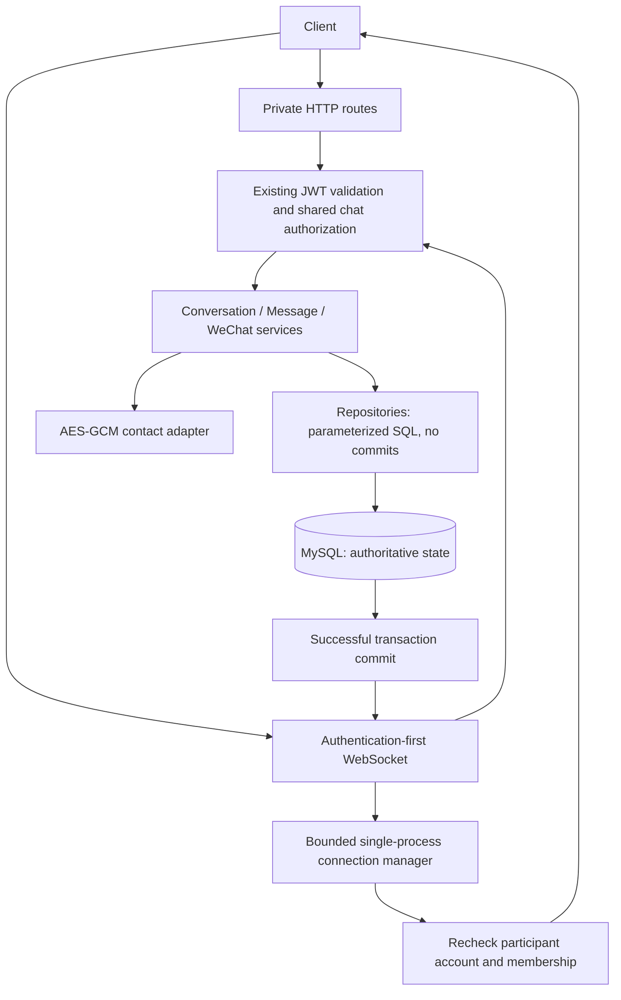

# Phase 13: private product conversations and consent-based contact sharing

Status: implementation decision, subject to independent final audit. This is not
a production-readiness or Phase 13 closure statement. No frontend feature is added.

## Boundaries and responsibility

Routes handle transport, strict input, response projections and safe error mapping.
Services own policy and transaction completion. Repositories own SQL, required locks
and persistence, and import neutral cursor types from `app/common/chat.py`, not
services. The connection manager does not store message history. WeChat is a consent
handoff, not an external WeChat API integration or payment integration.

The existing access-token service, account authorization, transaction helper,
deadlock retry policy, canonical public-product query and bounded in-process rate
limiter are reused. There is no route-to-route import in the new chat feature.
No broad Phase 12 refactor is included. `P12-ARCH-LOW-01` and
`P12-AUDIT-OPENAPI-01` remain previously identified, unresolved findings.

## Data model

One additive revision, `d13e4f5a6b7c`, follows `c12d3e4f5a6b`:

- `conversations`: internal UUID, unique `cv-` plus 32 random hexadecimal digits,
  buyer/seller/product foreign keys, unique buyer/seller/product identity,
  distinct-participant CHECK, creation/activity timestamps with microseconds.
  Buyer/activity/public-ref and seller/activity/public-ref indexes support private
  lists; product FK is indexed. User/product deletion is RESTRICT to preserve history.
- `messages`: internal UUID, unique `msg-` plus 32 random hexadecimal digits,
  conversation and sender FKs, content, server timestamp and canonical UUID client
  message ID. Unique `(conversation_id, sender_user_id, client_message_id)` makes
  retries durable. Conversation/time/public-ref supports deterministic history.
  CHECKs bound content to 2,000 characters/8,000 UTF-8 bytes and reference format.
- `wechat_share_requests`: conversation PK/FK, status, request/decision/revocation
  timestamps, nullable authenticated ciphertext. Participants derive from the
  conversation instead of duplicating mutable identities. CHECKs enforce valid
  states, timestamp shape and ciphertext only in APPROVED state.

Deleting a conversation explicitly cascades messages/handoff; there is no public
conversation deletion endpoint. Account lifecycle is soft status change, not an
implicit destructive history operation. A future erasure/retention workflow needs
separate policy and authorization. Development is migrated forward only; downgrade
verification is limited to a disposable MySQL database.

## Lifecycle and transaction policy

New conversations require a distinct active, email/phone-verified buyer and a product
which passes the existing complete public visibility policy, including seller
verification/profile, account and catalog eligibility. The server derives the seller.
Create/reuse remains unavailable if the product no longer qualifies publicly.

An active participant can read existing conversation/message history after product
pause/archive or counterparty suspension/ban/soft deletion. Existing conversations
may continue messaging after product pause/archive only while both accounts are
active. An inactive actor cannot read or write. Contact approval/request/retrieval
also require both accounts active. An active seller may **revoke** with an inactive
buyer, because withdrawing access must remain possible.

Mutations lock participant User rows in sorted UUID order, then the conversation,
then message/handoff state. Creation performs a current eligibility recheck after
account locks. Database uniqueness backs concurrent create/retry behavior. Only
known InnoDB deadlock failures are retried, at the whole-transaction boundary, at
most three attempts. No network sends occur inside these transactions.

Message service results are detached DTOs produced inside the transaction and
returned only after commit. New messages update conversation activity. Same client
ID/sender/conversation and identical content returns the original message with
`created=false`; changed content conflicts. Dispatch is attempted only for a newly
committed result. A lost ACK is recovered by retrying the same client ID or reading
history. There is no outbox, guaranteed delivery or exactly-once socket promise.

## Pagination and operational limits

Both private lists are newest-first keysets, default 20/max 50, timestamp plus opaque
public reference as the tie-breaker. HMAC-signed cursors bind account, list purpose,
conversation and page size. They use a distinct chat derivation domain from
`BROWSE_CURSOR_SIGNING_KEY`, not a JWT fallback. Missing/short signing configuration
fails closed with 503. Cursors are bounded to 512 characters and cannot select owners.
Projection queries include participant predicates and do not fetch a relationship
per row. Conversation listing performs two disjoint indexed role seeks, each limited
to `limit + 1`, then merges at most 102 candidates before joining product references.
Live activity can move a conversation ahead of an older list cursor; callers
refresh the first page to see such changes. This is a live keyset, not a snapshot.

Per-process account budgets per minute: create 20, send 60, read 120, consent write
20. HTTP pre-auth peer budgets: read 240/write 60, bounded 10,000-key maps. Invalid
JSON still consumes the peer budget. HTTP bodies are bounded to 1,024 actual bytes,
query strings to 1,200 bytes and body reads to five seconds. Only create and approve
accept JSON bodies; all other operations are bodyless. Duplicated JSON keys, query
keys, unknown fields and unsupported ownership fields are rejected.

WebSocket resources: 200 pending+authenticated connections globally, 20 per peer,
5 per user, 20 subscriptions per connection, 32 queued outbound events, 16,384-byte
frames/events. Connect attempts are 30/peer/minute; received frames 240/peer/minute
and 120/authenticated-user/minute. Authentication deadline is five seconds, inbound
idle timeout 60 seconds, write/close timeout five seconds. Limits and fanout remain
single-process; deploy one worker. A shared broker/distributed limiter requires a
future approved design, not an implicit horizontal-scaling claim.

## Contact cryptography and privacy

The dedicated `WECHAT_CONTACT_ENCRYPTION_KEY` is exactly 32 random bytes represented
as canonical URL-safe base64. It must not equal JWT or cursor key configuration.
The `cryptography` AESGCM adapter generates a fresh 12-byte random nonce; authenticated
associated data binds the envelope version and conversation public reference. Only
the seller can approve a pending request, and only an authorized private GET returns
plaintext. Request/decision responses, summaries, public products/profiles and general
socket events do not include stored contact material. No seller evidence is read.

Missing/malformed keys, wrong keys, tampering and cross-conversation ciphertext
substitution fail closed, with no plaintext or decoder/SQL details in errors. The
WeChat ID contract is 6–20 ASCII letters/digits/underscore/hyphen, beginning with a
letter; this phase does not accept phone numbers or personal documents as contacts.
Client-supplied chat text remains plain text, not trusted HTML. No automatic DLP is
claimed if users voluntarily type personal information in a normal message.

Key rotation requires an operational, backed-up re-encryption process: pause contact
operations, retain authorized access to the old key, decrypt and re-encrypt each
APPROVED row with fresh nonces and the same associated-data identity, verify, then
switch the application key. Merely replacing the key makes old contacts unreadable.
No online key-ring/rotation command is provided. Secrets belong in a secret store,
never in Git, shell logs or URLs. Revocation clears the stored ciphertext and blocks
subsequent reads but cannot erase contact copies already received.

## Security review scope

Controls are mapped to [OWASP API Security Top 10](https://api-security.owasp.org/editions/2023/en/0x11-t10/):
API1/3 participant predicates and explicit response fields; API2 existing JWT validation
and current-account checks; API4 bounded requests/connections/queues; API5 seller-only
consent decisions; API6 rate limits and terminal consent; API8 strict Origins, safe
errors/logs and no-store responses; API9 documented HTTP/event inventory. API7/10 do
not introduce an external fetch or provider in this feature.

Relevant [ASVS](https://asvs.owasp.org/) themes are input validation, authentication,
authorization, cryptographic storage, data protection and safe error handling. This
is a focused control review, not an ASVS certification or claim that every control
has been verified. The [OWASP WebSocket guidance](https://cheatsheetseries.owasp.org/cheatsheets/WebSocket_Security_Cheat_Sheet.html)
informs Origin validation, repeated authorization and resource limits.

Production still requires WSS/TLS termination, secure secret provisioning, deployment
and backup/retention review, monitoring without private payloads, and existing project
security blockers to be resolved. Existing short-lived access JWTs have no per-token
logout denylist: logout alone does not invalidate them immediately. Socket expiry is
enforced at JWT expiry, and account suspension is rechecked on sensitive operations
and when queued events drain. An operation already authorized in flight may complete;
this does not authorize another command after expiry.
