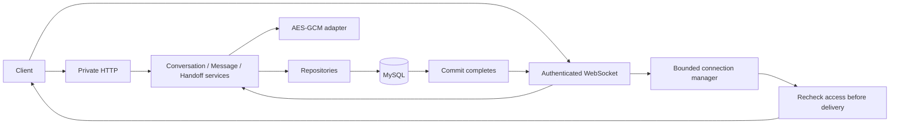

# Phase 13 — secure chat and WeChat handoff implementation evidence

Implementation report: 2026-10-25; dependency remediation update: 2026-10-26
(Asia/Shanghai). Implementation remains unstaged on
`feature/authentication`, committed HEAD `24b1bcd68720874a6379451d3e69a5d305652d6c`.
This is not independent audit closure or production approval.

## A. High-level architecture



Transport handles strict contracts and safe errors; shared services own authorization,
policy and transactions; repositories own parameterized SQL and never commit. Neutral
DTO/cursor types avoid repository-to-service imports. The existing JWT, account,
public-product visibility, transaction/retry and bounded limiter implementations are
reused. See [architecture decision](../architecture/ADR_PHASE_13_PRIVATE_CHAT.md).

## B. Implemented capabilities

Private product-linked create/reuse, participant-only conversation lists/details,
durable text messages, sender-scoped idempotent retries, bounded newest-first message
history, signed account/conversation/page-size-bound cursors, first-message socket
authentication, authorized subscriptions, multi-device delivery, timeout/backpressure
cleanup, and explicit seller-controlled contact consent are implemented.

New conversation eligibility follows canonical public visibility. Historical access
remains for active participants after product pause/archive; sending requires both
accounts active. Seller revocation remains possible when the buyer becomes inactive.
Denied/revoked requests are terminal. No frontend chat, payments, document extraction,
external WeChat API, Redis or Phase 14 functionality is introduced.

## C. Database

Revision **`d13e4f5a6b7c`**, parent **`c12d3e4f5a6b`**, adds only:

1. `conversations`: unique opaque reference, unique buyer/seller/product identity,
   distinct-participant CHECK, user/product FKs with RESTRICT, microsecond timestamps,
   buyer/activity/ref and seller/activity/ref indexes plus product index.
2. `messages`: unique opaque reference, sender and conversation FKs, canonical client
   UUID, unique conversation/sender/client-ID key, text size/reference CHECKs,
   conversation/time/ref and sender indexes. Conversation deletion cascades children.
3. `wechat_share_requests`: conversation PK/FK, normalized participants through parent,
   state/timestamps/ciphertext CHECKs, and encrypted contact only while APPROVED.

Development was advanced only. The disposable MySQL 8.4.11 cycle verified identical
prior data/schema hashes after upgrade, exact restoration after Phase 13 downgrade,
and exact upgraded fingerprints after re-upgrade. Alembic current/heads agree; no drift.

## D. Contracts

HTTP base `/api/v1/chat/conversations`:

| Method | Suffix |
| --- | --- |
| POST / GET | empty: create-or-reuse / list |
| GET | `/{conversation_ref}` |
| GET | `/{conversation_ref}/messages` |
| POST | `/{conversation_ref}/wechat/request` |
| POST | `/{conversation_ref}/wechat/approve` |
| POST | `/{conversation_ref}/wechat/deny` |
| POST | `/{conversation_ref}/wechat/revoke` |
| GET | `/{conversation_ref}/wechat` |

All nine HTTP successes are 200; errors and uniqueness/idempotency behavior are
explicit in OpenAPI. WS `/api/v1/chat/ws` client events: `authenticate`, `subscribe`,
`message.send`, `ping`; server events: `authenticated`, `subscribed`, `message.ack`,
`message.created`, `pong`, `error`, plus native safe close frames. Protocol version 1.
See [complete API/events and launch commands](../api/chat-api.md).

## E. Security and architecture review

- JWT algorithm/signature/type/issuer/audience/expiry reuse existing validation.
  Current account and membership checks protect commands, history and queued bytes.
- Strict mandatory socket Origin, authentication deadline, no token URLs/subprotocols,
  16 KiB events, bounded pending/authenticated connections, subscriptions and queues,
  rate limits before parsing, timeouts, fresh worker-thread database sessions.
- Service commit precedes ACK/broadcast; failed commit cannot dispatch. Database
  uniqueness and stable participant lock order serialize races and retries.
- Contact AES-GCM uses a dedicated key, random nonce and conversation-bound associated
  data. Wrong/missing keys and tampering fail closed. Only private GET can disclose an
  approved contact. No stored contact/evidence/storage key enters public or socket DTOs.
- No-store/private errors; SQL/crypto exception text and private payloads are not logged.
  Logging guards suppress URL credentials and WebSocket debug frame payloads.
- Conversation pagination uses two indexed bounded role branches rather than sorting
  an unrestricted combined participant history. No N+1 relationship retrieval.
- A real Uvicorn 0.51.0 SansIO compatibility defect was discovered: denial responses
  received duplicate Content-Length values. Omitting the application copy fixes strict
  client handshake parsing; a regression test and live missing-Origin checks passed.
- Reviewed against focused [OWASP API Security risks](https://api-security.owasp.org/editions/2023/en/0x11-t10/),
  [WebSocket guidance](https://cheatsheetseries.owasp.org/cheatsheets/WebSocket_Security_Cheat_Sheet.html)
  and relevant [ASVS themes](https://asvs.owasp.org/). This is not an ASVS certification.

## F. Verification evidence

### Dependency remediation update — 2026-10-26

**All required remediation gates passed; ready for independent final audit.**
Python advisories fell from 41 to zero; fresh full npm findings fell from 10 affected
nodes (4 High / 6 Moderate) to zero, and production npm from 2 High nodes to zero.
The fresh baseline includes the additionally flagged jsdom ancestor, unlike the
original nine-node result below. No advisory was ignored or certificate check bypassed.

Installed fixes: certifi 2026.10.19, filelock 4.2.1, Pillow 13.0.0,
follow-redirects 1.16.2, zod 4.6.6, vite 8.1.6, vitest/mocker 4.1.12, undici 7.30.1
and postcss-selector-parser 7.1.6 scoped under Tailwind 3.4.19. Tailwind was not
migrated to version 4. Two pre-update CSS fixture hashes still match byte-for-byte.

Focused dependency/media/Phase 13 tests: **317 passed**. Full backend run once:
**1,824 passed**, zero failed/skipped, one inherited warning. Full frontend run once:
**390 passed / 23 files**. Compilation, Ruff, pip check, TypeScript, ESLint, production
build and all three dependency audits passed. The Pillow-related real HTTP/media
workflow passed **161 checks**, with exact synthetic/media cleanup and server shutdown.
All 22 data fingerprints and schema hashes, existing HTTP/WebSocket code and canonical
OpenAPI hash are unchanged; read-only Alembic current/check confirms the same head/no
drift. No migration was applied or reversed during remediation.

See the [remediation matrix, advisory IDs, commands and nine-file scope](PHASE_13_DEPENDENCY_REMEDIATION.md).
This supersedes the dependency blockers below, not the outstanding operational
acceptance limitations. Phase 13 is not closed or declared production-ready.

### Original implementation evidence — 2026-10-25 (historical)

Commands run from `backend` use `.\.venv\Scripts\python.exe` (abbreviated `python`
below). Tests use synthetic fixtures or rollback transactions; never real user secrets.

| Command / gate | Result |
| --- | --- |
| `python -m pytest tests/unit/test_chat_domain.py tests/unit/test_chat_security.py tests/unit/test_chat_websocket.py tests/integration/test_chat_routes.py tests/integration/test_chat_concurrency.py -q --tb=short` | **222 passed**, 0 failed/skipped; inherited TestClient warning |
| `python -m pytest tests/integration/test_auth_routes.py tests/integration/test_profile_routes.py tests/integration/test_product_routes.py tests/integration/test_seller_verification.py tests/integration/test_seller_evidence_access_security.py tests/integration/test_product_personalization.py -q --tb=short` | **211 passed**, 0 failed/skipped |
| `python -m pytest tests/unit/test_project_foundation.py tests/unit/test_chat_websocket.py -q --tb=short` | **67 passed**, 0 failed/skipped after the explicit Docker-command expectation update |
| `python -m pytest -q --tb=short` | **1,821 passed**, 0 failed/skipped, 1 inherited warning, 203.11 seconds |
| `python -m scripts.chat_http_checks --allow-development-synthetic-writes` | **175 assertions passed** on MySQL 9.4.0; **175** on isolated 8.4.11; cleanup/data/media preserved |
| Isolated `python -m pytest tests/integration/test_chat_concurrency.py -q --tb=short`, three runs | **6 / 6 / 6 passed**, 0 failed/skipped; all 22 table fingerprints unchanged after each |
| `python -m alembic current`, `heads`, `history`, `check` | `d13e4f5a6b7c`, single head, valid chain, no new upgrade operations |
| Disposable `alembic upgrade head`, `downgrade c12d3e4f5a6b`, `upgrade head` | PASS; only verified loopback MySQL 8.4.11 on port 43306, never development |
| `python -m compileall -q app alembic scripts tests` | PASS |
| `python -m ruff check --no-cache app alembic scripts tests` | PASS |
| `python -m pip check` | PASS |
| `python -m scripts.audit_product_media` | Report only: 0 image rows, 0 issues |
| `python -m pip_audit --progress-spinner off` | **FAIL: 41 advisories / 3 installed packages**, below |
| Frontend `npm run test -- --run` | **387 passed / 22 files** |
| Frontend `npx tsc --noEmit`, `npm run lint`, `npm run build` | PASS; production build also runs `tsc -b` |
| Frontend `npm audit --json` | **FAIL: 4 High / 5 Moderate affected dependency nodes** |
| Frontend `npm audit --omit=dev --json` | **FAIL: 2 High affected production dependency nodes** |
| `git diff --check`, cached-name inspection | No whitespace errors; index empty |

The initial cache-enabled Ruff run panicked on a corrupted local cache. The no-cache
rerun passed; no cache cleanup, source suppression or ignored lint rules were used.
Initial test fixture/assertion failures were repaired without relaxing security controls.
The first complete backend run had 1 failure / 1,820 passes: the foundation test
still expected the pre-Phase-13 Docker command. Its exact expected command now
includes the SansIO protocol, 16 KiB frame limit, disabled compression and info logging;
the final full rerun above passed. No production guard was removed to satisfy it.
The first live run passed 35 checks then exposed the denial-response defect; the final
175-check runs include its correction. Assertions include repeated per-frame limit
checks, not 175 distinct feature categories.

The disposable cycle used `docker start phase12-mysql84` followed by
`python "$env:TEMP\phase13_isolated_runtime_gate.py"`. That task-owned temporary
verification helper was updated outside the repository; it is not a Phase 13 source
or staging candidate. It validates the disposable container/image/loopback port,
supplies credentials in process memory, runs the migration/concurrency/HTTP gates,
and stops (does not delete) the container in its finalizer. The container is stopped.

No deployed WSS/TLS or full Docker/NGINX runtime acceptance, real-browser chat UI,
horizontal-scaling/failover, sustained load benchmark or online key rotation was tested.
No standalone Python type checker is configured. Frontend tests verify compatibility,
not a frontend chat feature. Local operational secrets were supplied ephemerally to
the live harness; missing secrets intentionally fail closed in the unmodified `.env`.

### Original dependency findings (resolved by 2026-10-26 remediation)

| Installed Python package | Advisory count | Audit-reported fix |
| --- | --- | --- |
| certifi 2026.6.17 | 1 (`PYSEC-2026-4320`) | 2026.10.19 |
| filelock 3.32.0 | 3 (`CVE-2026-112940`, `112913`, `112907`) | 4.2.1 |
| Pillow 12.3.0 | 37 | 13.0.0 |

The initial implementation's only added dependency was `cryptography>=50.0.2,<51`,
installed as 50.0.2 using normal HTTPS and certificate verification. It remains
unchanged and has no finding in the fresh audit. The dependency-only follow-up is
documented above; no Tailwind 4 migration was performed.

Original npm affected nodes: `@vitest/mocker`, `vitest`, `postcss-nested`,
`postcss-selector-parser`, `tailwindcss`, `follow-redirects`, `undici`, `vite`, `zod`.
The original production audit reported `follow-redirects` and `zod` as High.
The separately scoped remediation now resolves these findings and the Tailwind 3
parser advisory, with affected earlier-phase security regressions rerun. Exact
before/after results and compatibility evidence are in the linked remediation report.

## G. Complete changed-file manifest

**34 modified tracked Phase 13 paths + 22 new Phase 13 paths = 56 paths.**
No deleted files. All paths below are relative to the repository root.

Modified:

```text
backend/.env.example
backend/Dockerfile
backend/app/api/v1/chat/routes.py
backend/app/api/v1/chat/websocket.py
backend/app/api/v1/router.py
backend/app/api/v1/wechat_sharing/routes.py
backend/app/core/config.py
backend/app/core/websocket_manager.py
backend/app/main.py
backend/app/models/__init__.py
backend/app/models/conversation.py
backend/app/models/message.py
backend/app/models/wechat_share_request.py
backend/app/repositories/conversation_repository.py
backend/app/repositories/message_repository.py
backend/app/schemas/conversation.py
backend/app/schemas/message.py
backend/app/schemas/wechat_share.py
backend/app/services/chat_service.py
backend/app/services/wechat_service.py
backend/requirements-dev.txt
backend/requirements.txt
backend/tests/conftest.py
backend/tests/fixtures/conversations.py
backend/tests/integration/test_chat_routes.py
backend/tests/unit/test_project_foundation.py
backend/tests/unit/test_public_handles.py
documentation/CURRENT_PROJECT_STATUS.md
documentation/api/chat-api.md
documentation/workflows/chat-workflow.md
documentation/workflows/wechat-sharing-workflow.md
frontend/package.json
frontend/package-lock.json
infrastructure/nginx/nginx.conf
```

New:

```text
backend/alembic/versions/d13e4f5a6b7c_private_conversations_messages.py
backend/app/api/chat_dependencies.py
backend/app/common/chat.py
backend/app/common/wechat.py
backend/app/core/chat_limits.py
backend/app/core/chat_logging.py
backend/app/core/chat_security.py
backend/app/integrations/wechat_cipher.py
backend/app/repositories/wechat_share_repository.py
backend/app/schemas/chat_events.py
backend/app/services/chat_authorization.py
backend/app/services/message_service.py
backend/scripts/chat_http_checks.py
backend/tests/integration/test_chat_concurrency.py
backend/tests/unit/test_chat_domain.py
backend/tests/unit/test_chat_security.py
backend/tests/unit/test_chat_websocket.py
backend/tests/unit/test_dependency_compatibility.py
documentation/architecture/ADR_PHASE_13_PRIVATE_CHAT.md
documentation/phases/PHASE_13_DEPENDENCY_REMEDIATION.md
documentation/phases/PHASE_13_SECURE_CHAT.md
frontend/tests/unit/dependency-compatibility.test.ts
```

`postman/README.md` has a separate, unattributed BOM-only change observed during resume;
it was preserved, not edited or silently reverted, and is excluded from Phase 13.

## H. Known limitations and blockers

Security: current dependency audits pass; production key provisioning and rotation,
TLS deployment, privacy retention and broader operational acceptance remain. Access
JWTs inherit short-lived stateless logout semantics. A pre-expiry accepted transaction
may commit after a connection closes; history recovers it. Revocation cannot erase copies.

Operational: one-process broadcasting/rate limits, no distributed broker/outbox,
best-effort events, no guaranteed ordering/exactly-once delivery, and bounded but
non-snapshot conversation lists. Shared peer limits may constrain users behind NAT.

Deferred: frontend chat, attachments, read receipts, typing, online key rotation,
contact re-request after terminal decisions, retention/erasure workflows, Phase 14.

Prior findings **remain unresolved**: `P12-ARCH-LOW-01` and `P12-AUDIT-OPENAPI-01`.
Private production object storage and other previously documented deployment blockers
are not resolved by a backend chat implementation.

## I. Git and data preservation

Branch `feature/authentication`; HEAD remains
`24b1bcd68720874a6379451d3e69a5d305652d6c`. Index empty. All Phase 13 edits are unstaged.
No staging, commit, push, branch creation or destructive Git operation was performed.
All 13 protected PDF artifacts remain untracked, with SHA-256 matching the Phase 12
audit baseline. No output/tmp path is part of the Phase 13 manifest. Unattributed
`postman/README.md` BOM-only change is preserved separately.

Final read-only verification after all regression tests: all **18 prior application
data-table full-content fingerprints** and **19 prior table-schema hashes** match
the pre-implementation baseline. Only the expected Alembic version value changed.
The three new tables are empty after synthetic cleanup; all 22 tables are accounted
for. Existing seller-evidence and product-media stores remain empty and unchanged.

The dependency follow-up additionally verified all 22 data and schema fingerprints
against its pre-remediation baseline, with no Alembic version change and an identical
canonical OpenAPI hash. Existing application source and migration were not edited.

Final Git inventory: **35 unstaged tracked modifications** (34 Phase 13 plus the
unattributed `postman/README.md` change), **35 untracked paths** (22 Phase 13 plus
13 protected artifacts), **0 staged**, **0 deleted**. The 56-path manifest above
matches exactly after excluding those unrelated paths. `git diff --check` passes.
Development was never downgraded, reseeded, truncated or recreated. Synthetic live
and race fixtures delete only their known generated IDs and verify full data hashes.

## J. Verdict

**READY FOR INDEPENDENT FINAL AUDIT.**

Dependency remediation and required local regressions passed. This is not independent
audit closure or production readiness. Independent security review, operational
acceptance and explicit human-owned Git approval remain. No Phase 14 started.
